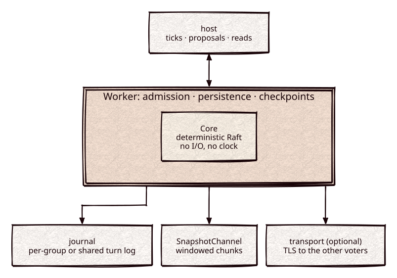

# consensus

Part of [Kronuz C++ Libraries](https://github.com/Kronuz/cpp-libraries), a collection of small, reusable C++ libraries.

[](https://github.com/Kronuz/consensus/actions/workflows/ci.yml)
[](LICENSE)


Header-only deterministic Raft for C++20: an I/O-free core whose state is durable in journal
before anything is visible. The core is a state machine that takes events and returns
actions; the persistence Worker, snapshot transfer and an optional TLS transport run it. Reach
for it to replicate state across a handful of voters when you need to reason exactly about
durability.



## ✨ Highlights

- **Deterministic core.** `Core::step(event)` returns actions; time, I/O and randomness come
  from the host, so every schedule is reproducible.
- **Durable before visible.** Votes, appends and commit advances are persisted before anything
  depends on them, and a storage failure fences the group.
- **Membership changes through the log.** Voters, learners and witnesses change one at a time,
  and a replacement completes across leader changes.
- **Safer elections and reads.** Pre-vote, the leader-contact guard, CheckQuorum and leadership
  transfer; linearizable reads go through quorum probes, with no leases.
- **Pipelined replication and windowed snapshot transfer,** both off by default and raised by
  the host.
- **Checkpoints and snapshots.** Images are staged, verified and published around a short
  freeze, which [docs/MEASUREMENTS.md](docs/MEASUREMENTS.md) times.
- **Checked hard.** Randomized simulation with seeded mutants, liveness runs, compatibility
  fixtures and fuzzed decoders.

## 🚀 Quick start

The core is an event loop: step it, carry out the actions it returns, and report back. A single
voter, persisting through journal:

```cpp
#include "completion/posix.h"
#include "consensus/core.h"
#include "consensus/storage.h"
#include "journal/journal.h"

#include <deque>
#include <filesystem>
#include <iostream>

using namespace kronuz::consensus;

int main() {
	FixedConfiguration config;                          // one voter, node 1
	config.cluster[0] = 'Q'; config.configuration[0] = 'S';
	config.local = 1; config.voters = {1};

	auto dir = std::filesystem::temp_directory_path() / "consensus-quick-start";
	std::filesystem::remove_all(dir);
	std::filesystem::create_directories(dir);
	kronuz::journal::PosixIO io(dir.string());
	kronuz::journal::Journal journal(io, 4 * 1024 * 1024);
	journal.create(Identity{'Q'});
	journal.append_batch(encode_initialization(config));

	RecoveredState state; state.configuration = config;
	Core core(config, std::move(state));
	std::deque<Action> work;
	auto enqueue = [&](Actions actions) { for (auto& a : actions) { work.push_back(std::move(a)); } };
	auto pump = [&] {
		while (!work.empty()) {
			auto action = std::move(work.front()); work.pop_front();
			if (auto p = std::get_if<Persist>(&action)) {
				journal.append_batch(encode_storage_batch(p->batch));     // durable first
				enqueue(core.step(Persisted{p->token}));
			} else if (auto c = std::get_if<Committed>(&action)) {
				for (const auto& e : c->entries) {
					if (e.kind == EntryKind::Command) { std::cout << "apply " << e.payload << '\n'; }
				}
				enqueue(core.step(Applied{c->entries.back().index}));
			}
		}
	};

	enqueue(core.step(Start{})); pump();
	enqueue(core.step(Tick{1000, 1000})); pump();        // the host owns time: now, election delay
	enqueue(core.step(Propose{1, "set x=1"})); pump();
	std::cout << "commit " << core.committed() << '\n';
	// apply set x=1
	// commit 2
}
```

[`examples/demo.cc`](examples/demo.cc) is this loop with creation and recovery. Real
deployments use `Worker`, which owns the loop with admission, checkpoints and
completion-driven I/O.

## 📦 Installation

Requires a C++20 compiler and CMake 3.16 or newer. CMake fetches
[journal](https://github.com/Kronuz/journal) at a pinned commit; the optional transport
(`-DCONSENSUS_TRANSPORT=ON`) also needs OpenSSL 3 and fetches
[reactor](https://github.com/Kronuz/reactor). CI builds it on Linux (x86_64, arm64), macOS
(arm64, x86_64), and FreeBSD, plus ASan, UBSan, and TSan builds.

```cmake
include(FetchContent)
FetchContent_Declare(consensus
  GIT_REPOSITORY https://github.com/Kronuz/consensus.git
  GIT_TAG        a4c28e090434d3b823531a31c7b748afb85e96ef)  # main tracks the tip
FetchContent_MakeAvailable(consensus)

target_link_libraries(my_app PRIVATE consensus::consensus)   # consensus::transport for TLS peers
```

Then `#include "consensus/core.h"` and `"consensus/storage.h"`.

## 🎯 When to use it

Use it to replicate a state machine across three or five voters when you need to know exactly
when something is durable, including many small groups per machine on journal's shared turn
log.

Not for:

- A ready-made replicated database or key-value service: it is the protocol and its
  persistence, and the application supplies the state machine and idempotency.
- Byzantine faults: Raft trusts authenticated members.
- Lowering log limits without the journal capacity for the history already retained
  ([docs/RETAINED-STATE.md](docs/RETAINED-STATE.md)).

## 📚 Documentation

- [ARCHITECTURE.md](ARCHITECTURE.md): the host contract, membership, elections, replication,
  the Worker, checkpoints, snapshots and the transport.
- [docs/RETAINED-STATE.md](docs/RETAINED-STATE.md): how retained history is bounded, retired
  and funded across checkpoints.
- [docs/MEASUREMENTS.md](docs/MEASUREMENTS.md): checkpoint and transfer measurements, and the
  qualification log.
- [AGENTS.md](AGENTS.md): repository map and the rules for changing protocol code.
- [Catalog entry](https://github.com/Kronuz/cpp-libraries/blob/main/AGENTS.md#consensus):
  include lines, targets, dependencies and key API.

## 🛠️ Building and testing

```sh
cmake -S . -B build -DCMAKE_BUILD_TYPE=Release
cmake --build build
ctest --test-dir build
```

`tools/mutants.sh`, `tools/compat.sh`, `tools/fuzz.sh` and `tools/coverage.sh` run the
mutation, compatibility, fuzzing and coverage checks; `-DCONSENSUS_FUZZ=ON` builds the
libFuzzer targets (Clang).

## 🤝 Contributing

Protocol changes need a simulation case and, for a safety property, a mutant the harness
catches. Read [AGENTS.md](AGENTS.md) and the catalog's
[rules of engagement](https://github.com/Kronuz/cpp-libraries/blob/main/AGENTS.md#rules-of-engagement)
before opening a pull request; CI must pass on every platform.

## 📄 License

MIT, Copyright (c) 2026 Germán Méndez Bravo. See [LICENSE](LICENSE).
