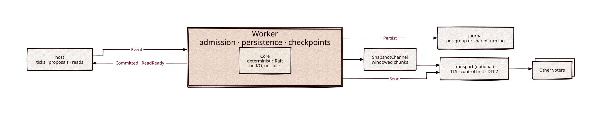

# consensus

[](https://github.com/Kronuz/consensus/actions/workflows/ci.yml)
[](LICENSE)


A deterministic Raft implementation in C++20: a core state machine with no
sockets, clocks, or filesystem calls, plus the persistence worker, snapshot
transfer, and an optional TLS transport that run it. For systems that replicate
state across a handful of voters and need to reason exactly about durability.



## ✨ Highlights

- **Deterministic core.** `Core::step(event)` returns actions; time, I/O, and
  randomness come from the host, so every schedule is reproducible.
- **Durable before visible.** Votes, appends, and commit advances are persisted
  before anything depends on them; a storage failure fences the group.
- **Membership changes** through the log: voters, learners, and witnesses, one
  change at a time, with replacements that survive leader changes.
- **Safer elections:** pre-vote, the leader-contact guard, CheckQuorum, and
  leadership transfer.
- **Pipelined replication** and **windowed snapshot transfer**, both off by default
  and raised by the host.
- **Checkpoints and snapshots** without stalls: images are staged, verified, and
  published around a short freeze.
- **Linearizable reads** through quorum probes, with no leases.
- **Checked hard:** randomized simulation with seeded mutants, liveness runs,
  compatibility fixtures, and fuzzed decoders.

## 📦 Installation

Requires a C++20 compiler and CMake 3.16 or newer. It fetches
[journal](https://github.com/Kronuz/journal) at a pinned commit; the optional
transport (`-DCONSENSUS_TRANSPORT=ON`) also needs OpenSSL 3 and fetches
[reactor](https://github.com/Kronuz/reactor). CI builds it on Linux (x86_64,
arm64), macOS (arm64, x86_64), and FreeBSD, plus ASan, UBSan, and TSan builds.

```cmake
include(FetchContent)
FetchContent_Declare(consensus
  GIT_REPOSITORY https://github.com/Kronuz/consensus.git
  GIT_TAG        main)
FetchContent_MakeAvailable(consensus)

target_link_libraries(my_app PRIVATE consensus::consensus)
# and consensus::transport for the TLS peer transport
```

## 🚀 Quick start

The core is an event loop: step it, carry out the actions it returns, and report
back. A single voter, persisting through journal:

```cpp
#include "consensus/core.h"
#include "consensus/storage.h"

using namespace kronuz::consensus;

Core core(configuration, std::move(recovered));
std::deque<Action> work;
auto enqueue = [&](Actions actions) { for (auto& a : actions) { work.push_back(std::move(a)); } };

enqueue(core.step(Start{}));
enqueue(core.step(Tick{now, election_delay}));     // the host owns time
enqueue(core.step(Propose{request_id, "set x=1"}));
while (!work.empty()) {
	auto action = std::move(work.front()); work.pop_front();
	if (auto p = std::get_if<Persist>(&action)) {
		journal.append_batch(encode_storage_batch(p->batch));    // durable first
		enqueue(core.step(Persisted{p->token}));
	} else if (auto c = std::get_if<Committed>(&action)) {
		apply(c->entries);                                       // your state machine
		enqueue(core.step(Applied{c->entries.back().index}));
	}
}
```

[`examples/demo.cc`](examples/demo.cc) is this loop as a complete program, with
creation and recovery. Real deployments use `Worker`, which owns this loop with
admission, checkpoints, and completion-driven I/O.

## 🎯 When to use it

- ✅ Replicating a state machine across three or five voters, where you need to
  know exactly when something is durable.
- ✅ Many small groups per machine, on journal's shared turn log.
- ❌ A ready-made replicated database or key-value service: this is the protocol
  and its persistence; the application supplies the state machine and idempotency.
- ❌ Byzantine faults: Raft trusts authenticated members.

## 📚 Documentation

- [ARCHITECTURE.md](ARCHITECTURE.md): the host contract, membership, elections,
  replication, the Worker, checkpoints, snapshots, and the transport.
- [docs/MEASUREMENTS.md](docs/MEASUREMENTS.md): checkpoint and transfer
  measurements, and the qualification log.
- [AGENTS.md](AGENTS.md): repository map and the rules for changing protocol code.

## 🛠️ Building and testing

```sh
cmake -S . -B build -DCMAKE_BUILD_TYPE=Release
cmake --build build -j4
ctest --test-dir build --output-on-failure
```

`tools/mutants.sh`, `tools/compat.sh`, `tools/fuzz.sh`, and `tools/coverage.sh` run
the mutation, compatibility, fuzzing, and coverage checks.

## 🤝 Contributing

Issues and pull requests are welcome. Protocol changes need a simulation case and,
for a safety property, a mutant the harness catches; read [AGENTS.md](AGENTS.md)
first. CI must pass on every platform.

## 📄 License

MIT. See [LICENSE](LICENSE).
